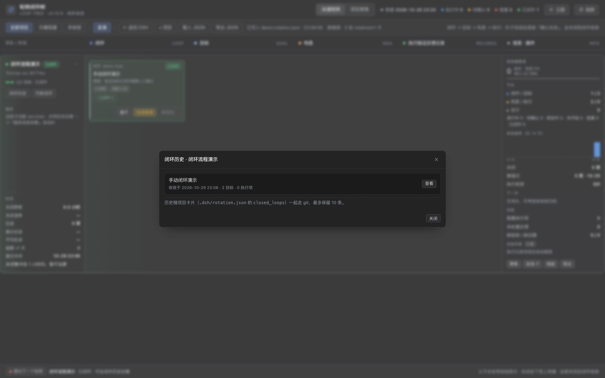
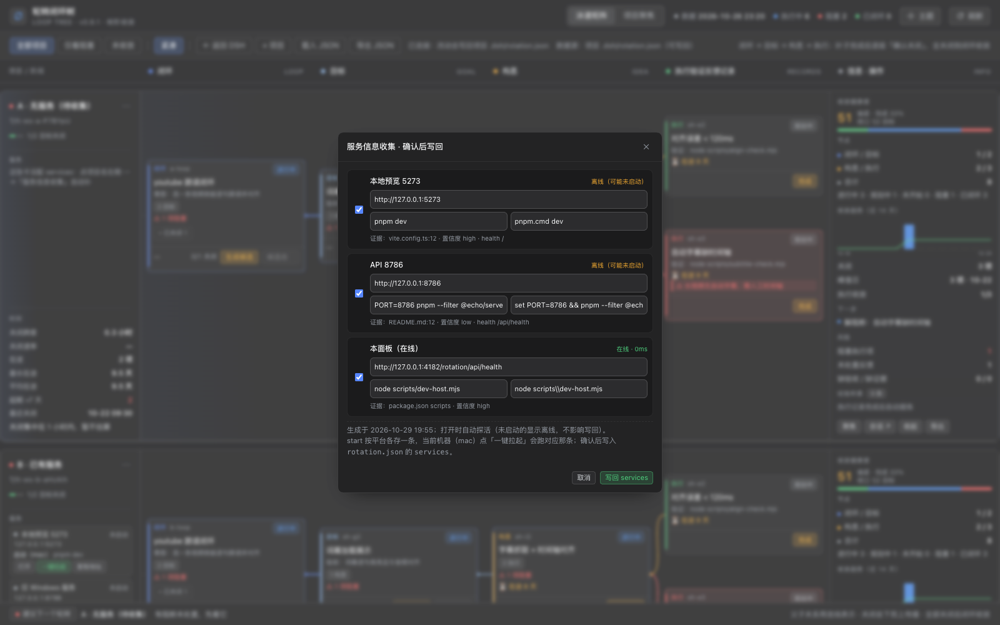
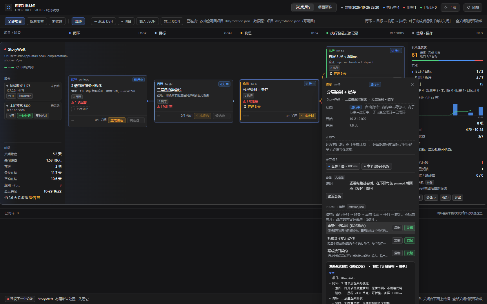
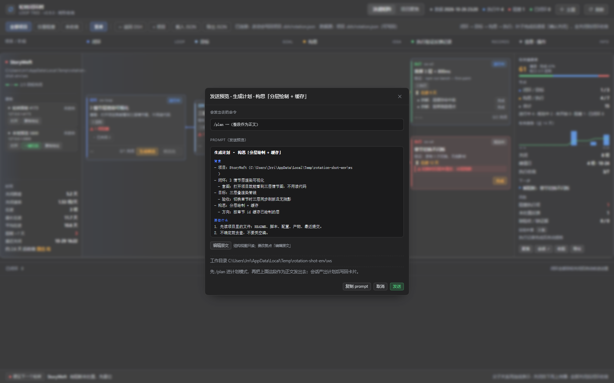

# 轮转闭环树面板 · DSH 插件（v0.11.0，真机可用）

把「多项目闭环树」做成 DSH 插件：一个泳道视图里同时看多个项目的
`闭环 → 目标 → 构思 → 执行验证反馈记录`，每个节点带可复制的结构化 prompt、可发起的会话、
可一键拉起的项目服务；构思卡直接开「生成计划 / 执行计划」，落地过程交给 DSH 的 `/plan` 与 `/goal`。

## 当前形态（M0 已跑通）

```
package.json          插件清单：dsh.bundle.patch + dsh.client
cordis.patch.yml      安装后由 profile 自动挂载 host 半
lib/index.js          host 半：/rotation/app/*（面板）、/rotation/api/*（数据/会话/服务）
lib/store.mjs         注册表 + 卡片读写（validate → tmp+rename 原子写）
lib/runner.mjs        节点会话执行器（ctx.agents + session/event）
lib/services.mjs      服务探活 / 一键拉起 / 停止
lib/client.js         client 半：DSH Web 右栏「轮转」入口（__ModuleLoader__ 形态）
lib/core.mjs          rotation/v1 校验与树工具（host 与 CLI 共用）
web/                  面板本体：index.html + cards.js（file:// 兜底数据）
samples/              5 张示例卡（M1 会迁到各项目 workspace 的 .dsh/rotation.json）
scripts/dev-host.mjs  不装 DSH 也能验证 host 半的假宿主
serve.mjs             旧开发服务器（:4173，M3 后退役）
```

本地验证 host 半：

```bash
npm run dev            # http://127.0.0.1:4180/rotation/app/
curl -s localhost:4180/rotation/api/health
```

装进 DSH：本机是 **link 安装**（profile 里软链指向本仓库），更新 = 改仓库 / `git pull` → 刷新面板，
改了 `lib/` 才重启 DSH。仓库不再产出 `.tgz`；换机器时装仓库目录，或将来的 GitHub 仓库地址。
详细步骤见 `INSTALL.md` §一。

## M1 数据层（已完成）

```
~/.dsh/rotation/registry.json     项目注册表 [{id,name,workspace,file}]
<workspace>/.dsh/rotation.json    卡片真身（rotation/v1，跟着项目走）
```

注册表按「本机可见」解析：`workspace` 目录不在本机的条目视为另一台机器的登记（`~/.dsh` 走 git 同步，
绝对路径各机器不同），不显示、不占 id / 目录，写回时原样保留——不会把另一台机器的登记冲掉。

接口：

| 方法 | 路径 | 说明 |
|---|---|---|
| GET | `/rotation/api/projects` | 注册表 + 卡片是否存在 |
| POST | `/rotation/api/projects` | `{name, workspace}` 注册项目，自动建 `.dsh/rotation.json` 模板 |
| GET | `/rotation/api/cards` | 所有项目的卡片 |
| DELETE | `/rotation/api/projects/<id或文件名>` | 从注册表移除（不删项目里的卡片文件） |
| PUT | `/rotation/api/cards/<id或文件名>` | 校验 → 原子写（不留 `.bak`，历史交给 git）；校验不过 422 |

面板变化：工具栏多了「+ 项目」、泳道悬停出现「✕」移除；数据源文案改成「项目 .dsh/rotation.json（可写回）」；
所有请求走 `api()` 前缀，插件下是 `/rotation/api`，旧 `:4173` 服务下是 `/api`。

迁移样例：`npm run migrate`（干跑），`npm run migrate -- --write` 真正写入，幂等（目标已存在就跳过）。

## M2 会话（已完成，等待真机验证）

执行器 `lib/runner.mjs` 走 **DSH 进程内 agent 服务**，不再 spawn `dsh --profile headless`：

```
ctx.agentDefaultModel.currentSelection()      → { provider, model }（GUI 里选的那套）
ctx.agents.create({ sessionId, agentOptions, meta:{cwd}, setup })
agent.followup(<user message>)
ctx.on('session/event', …)                    → turn/start · assistant/message · turn/end
```

- 事件映射：`turn/start` → 运行中；`assistant/message` → 结果预览；`turn/end(completed)` → 完成；其它 reason → 失败
- 结束后把 `session{ id,status,cwd,task_id,started_at,ended_at,result,error }` 写回卡片
- 15 分钟超时自动中断；同节点单运行；全局并发上限 3
- 接口：`GET /rotation/api/run-config`、`POST /rotation/api/run`、`GET /rotation/api/runs`、`POST /rotation/api/run/cancel`

因为走进程内服务，凭据、provider 路由、模型选择都沿用 GUI 配置——这同时满足「模型调用必须走网关」的本机铁律。

验证：`scripts/dev-session-mock.mjs` 用假 ctx 跑三种路径（done / failed / cancelled），全部 PASS。

## M3 服务（已完成）

`lib/services.mjs`：探活（1.2s 超时，HTTP <500 算在线）、一键拉起（shell + 独立进程组）、
停止（SIGTERM → 3s 后 SIGKILL）。`health` 以 `/` 开头时按「相对卡片 url 的路径」拼接。

0.9.2 起 `start` / `stop` / `cwd` 支持**平台映射**：同一份 `rotation.json` 在多台机器间同步，
点「一键拉起」时按当前宿主平台（`process.platform` → mac / windows / linux）挑对应那条，
不会把 mac 的写法拿到 Windows 上执行。项目名右侧的 `⋯` 菜单可让 AI 读项目自动收集服务。

接口：`GET /rotation/api/services?file=<id>`、`POST /rotation/api/service/start`、`POST /rotation/api/service/stop`、
`POST /rotation/api/services/collect`、`GET /rotation/api/services/collect?file=<id>`、
`POST /rotation/api/services/probe`、`PUT /rotation/api/services`。

实测：`host` 探活 200·9ms；`web` 从 down → 拉起后 up·200ms（pid 8444）→ 停止后 down 且端口释放。

## 构思动作与执行记录（0.8.0）

构思是落地的核心思路，不再让模型先吐一批候选执行项；构思卡直接开两个手动动作，
「执行验证反馈记录」列只当落地过程的记录看：

| 动作 | 触发 | DSH 侧实际发生什么 | 落点 |
|---|---|---|---|
| 生成计划 | 构思卡「生成计划」→ **发送预览**确认 | 起一个普通 DSH 会话，`/plan` 进计划模式，正文是分段的结构化 prompt；agent 调研仓库后用 `exit_plan_mode` 交计划 | `idea.plan`（目标 / 验证命令 / 步骤 / 全文） |
| 执行计划 | 构思卡「执行计划」→ **发送预览**（可改单行目标） | **同一会话**先 `/plan off`，再 `/goal <objective>`，由 goal 轮次驱动执行 | 执行记录卡 + 会话结果 |
| 反馈提炼 | 执行记录 done 后自动 | 同一会话追问「复盘踩坑，只输出 JSON」 | `loop.lessons[]` |

- 数据只新增三个可选字段：`idea.plan`、`loop.lessons`、`exec.action`（plan / exec / reflect），老卡不用迁
- 记录列：一次会话一条记录（id 如 `<ideaId>-p1`），带实时状态（启动中 / 运行中 / 完成 / 失败 / 已取消）；
  **已完成的记录常驻显示，不参与「已关闭 n」折叠**，一眼能看出哪些还在跑、哪些跑完了
- 面板用 run 的 `nodeId`（构思 id）与 `recordId` 认领同一个会话；运行中按钮禁用，轮询到终态再刷新卡片
- 接口：`POST /rotation/api/action/plan|exec|reflect`，body `{file,nodeId}`；
  预览里改过时 plan 带 `prompt`、exec 带 `objective`，原样发送
- 发送编排：plan 用 `/plan\n<多行正文>`（换行保留，气泡里就是分段的样子）；exec 用单行 `/goal` 目标，
  完整正文只当命令不可用时的退回内容；命令失败/缺失时自动退回同一份正文
- 目标卡 / 闭环卡仍保留「生成候选 / 候选池」（拆目标、拆构思不变）
- 不自建编排器：波次、重试、验证都由 DSH 的 `/plan`、`/goal` 与会话本身承担，面板只管记录与回写
- 格式规范与四类 prompt 的统一实现见 [docs/prompts.md](docs/prompts.md)；结构自检 `npm run mock:prompt`

验证：`npm run mock:action`（假命令服务 + 假 agent 走通 计划 → 执行 → 提炼），已并入 `npm run preflight`；
样例见 `samples/execution-records.rotation.json`。

## 一个目标一个构思（0.8.2）

一个目标只落地一条实现路径。候选池不是「多个构思」，而是**同一个构思槽位的对比**：

- 候选池（目标卡「生成候选」）：仍生成 3 条互斥路线，每条带 `strength`（优势：省时 / 好验证 /
  复用现有资产 / 风险更低），弹窗在标题下展示「优势」便于横向对比；优势只用于对比，采纳时不写进卡片
- 采纳即锁定：采纳 1 条后目标锁定，其余候选由服务端清空；再「生成候选 / 采纳」返回 409 `IDEA_EXISTS`，
  面板上按钮降透明度标成不可用（`aria-disabled`，仍可聚焦/点击），点一下用 toast 说清为什么不能生成
- AI 拆构思（详情卡「AI 拆出构思」/「+ 构思」菜单）：预览从多选改成**单选**，只写入 1 条；
  prompt 要求每条先写一句优势；目标已有构思时「AI 拆出构思 / 手动添加构思」同样标成不可用 + toast 原因
- 卡片写回（PUT）：目标从 0–1 个构思增加到 2 个时 422 拒绝；旧卡里已经有多条的仍可保存（只给警告）
- 存量清理：`npm run migrate:single-idea` 干跑看清楚，`--write` 才写盘；每个目标保留第一条构思，
  其余整体移入 `<卡片>.single-idea-backup.json`，不删数据
- prompt 模板「拆出构思 / 重新生成构思」改成只要 1 条 + 优势
- 验证：`npm run mock:idea-lock`（12 项断言：采纳锁定、重复采纳 409、重复生成 409、PUT 422、旧卡放行、迁移备份），已并入 `npm run preflight`

## 真机验证（已完成一部分）

用 `scripts/real-plugin-check.sh` 在**真实 DSH 进程**里验证过（复制 web profile 成一次性 `rotationtest`）：

| 验证 | 结果 |
|---|---|
| 插件装进 profile | `node_modules/dsh-looptree-dashboard` ✓，bundles 尾项写入 ✓ |
| host 半挂载 | `/rotation/api/health` 200、`/rotation/app/` 200、`/rotation/api/cards` 200 ✓ |
| client 半加载 | boot 清单里有 `{"id":"dsh-looptree-dashboard","url":"plugins/??dsh-looptree-dashboard/client.js…"}` ✓ |
| 中文项目名 | `真机项目` → id `project-y85w`，注册 + 建卡 ✓ |
| 卡片写回 | PUT 改标题 200，磁盘 `.dsh/rotation.json` 同步 ✓ |
| 清理 | 测试项目已移除，真实注册表回到 `[]` ✓ |

**真机跑客户端时抓到并修掉的 3 个 bug**（只有真装进去才会暴露）：

| 问题 | 现象 | 修法 |
|---|---|---|
| client bundle 的 `id` 用了 `dsh-external/<pkg>` | `loaded without registering "dsh-looptree-dashboard"`，整个 web boot 失败 | `id` 必须等于包名；并补 `exports.inject = ['slots']` |
| host 未声明 `agents` 服务 | `/api/run` 500：`cannot get property "agents" without inject` | `inject = ['webServer','agents','agentDefaultModel']` |
| `turn/end` 只记 `reason.kind` | 卡片只显示「turn 结束原因：error」 | 透传 `reason.error.message`，现在显示真实 401 文本 |

**真机会话测试结论**：`ctx.agents.create` + `followup` + `session/event` 全链路走通（能看到
`agent/inbox/spliced` → `turn/start` → `assistant/attempt` → `turn/end`），但本机这次跑出来的
`turn/end` 是 **401 Authentication Fails**（`.credentials.yaml` 里的 key 在厂商侧无效，
且这份 DSH 配置里没有指向网关的 provider 路由）。这是环境问题，不是插件问题。

> 若要把某个项目钉到网关路由：注册时带 `provider`/`model`，注册表会存下来，runner 优先用它：
> `POST /rotation/api/projects {"name":"x","workspace":"/w","provider":"<网关 provider>","model":"<模型>"}`

**会话已跑通（真机、真模型）**：把 profile 里 `llm-deepseek` 的 `baseURL` 指到网关后：

```yaml
# ~/.dsh/profiles/<profile>/cordis.patch.yml
- id: llm-deepseek
  config:
    baseURL: http://llm.riverbegin.cn/v1
```

一次真实会话的结果（本机实测）：

```
POST /rotation/api/run → status running
→ assistant/message: {"content":[{"type":"text","text":"OK"}]}
→ turn/end: {reason:{kind:"completed"}}
卡片: session = {status:"done", result:"OK", id:"session-2877a494-…"}
```

即：`ctx.agents.create` → `followup` → `session/event` → 结果写回卡片，全链路在真实 DSH 里成立。

**入口结论（0.2.1-rc.3 实测）**：client 半激活正常（`document.documentElement.dataset.dshRotation === '1'`，
控制台零错误），但 `sidebar.right.pane.tab` 注册的「轮转」标签**没有出现在右栏标签条里**
（右栏开「工作区文件」时只有 `文件` 一个标签）。右栏标签条似乎只列运行时打开的 pane，
不列插件静态注册的 tab。

**面板在真机里可用**（Playwright 跑真实浏览器 + 真实宿主）：

- `GET /rotation/app/` 正常渲染，空状态→添加项目→卡片树→「数据源：项目 .dsh/rotation.json（可写回）」
- 通过面板自己的接口注册项目：`200 {id:"project-z48d", …}`，刷新后项目出现在泳道里
- 控制台零错误

**入口（0.2.2，已实测）**：左栏「轮转闭环树」——`sidebar.panellist` 注册条目，点击在主区用 iframe
打开面板（`main` 槽，key=`rotation`）。右下角浮标已移除，不再有第二个入口。（与框架无关的 DOM 注入，
位置在应用自带圆形按钮下方，不遮挡），点一下就在新标签打开面板。真机验证：
按钮存在 → 点击 → popup 的 URL 是 `/rotation/app/`、标题正确、页面零报错。

也可以直接用 URL：`http://<dsh-host>:<port>/rotation/app/`（`/rotation` 会 302 过去）。
右栏 `sidebar.right.pane.tab` 标签不显示（该标签条只列运行时 pane），不再作为主入口。

## M4 准备（进行中）

- **联调宿主**：`MOCK_AGENTS=1 node scripts/dev-host.mjs` 会在假 ctx 里挂一个 mock agent，
  于是面板的「发起会话」可以真的被点下去，状态点会走 运行中 → 完成
- **client 契约**：`npm run mock:client`（9 项断言，含无 slots 降级）
- **调试钩子**：页面里 `window.__rotation.refreshRuns()` / `.runs` / `.state` 可手动触发刷新与查状态
- **后台标签页也会刷新**：切走再切回立刻同步一次，不再显示过期状态
- **服务日志**：服务块里出现「日志」按钮（有输出时），弹窗看最近 1500 字符
- **打包自检**：`npm run lint:plugin`（27 项：清单字段、patch、files、host/client 契约）
- **打包产物验证**：`npm run verify:tarball` —— 解包到临时 node_modules，用**装进去的那份文件**跑
  health / panel / cards 三个真实请求 + client 半契约（抓 `files` 白名单漏项、相对路径错位这类事故）
- **一条命令全跑**：`npm run preflight`（lint → client → 会话状态机 → 样例 → tarball）


- 空注册表时面板显示引导卡片（「添加第一个项目」），不再退回样例数据：
  服务端能应答就算连上，空注册表是「还没有项目」而不是「连不上」
- `dsh.engines.dsh >= 0.2.1-rc.3`：把插件依赖的宿主版本写进清单
- runner 在拿不到 provider/model 时不传 agentOptions，交给宿主默认选择
- `npm run mock:client`：用假浏览器环境验证 client 半契约（9 项断言）

---
# 轮转闭环树面板（v0.11.0 · 可读写 rotation/v1）

> 一个工作区一张闭环卡：`闭环 → 目标 → 构思 → 执行`。构思记录全闭环自动收口；**目标与闭环必须人点「确认收敛」才闭环**，
> 闭环后项目留在主泳道，可在「闭环历史」里回看。

## 每天怎么用（3 步）

1. 双击 `start.command`（或 `node serve.mjs`），浏览器打开 http://127.0.0.1:4173/
2. 在这个面板上做三件事：看哪条闭环有阻塞、子项闭环后在泳道头/卡片点「确认收敛」收口、收敛后去「闭环历史」回看或开新闭环
3. 改完就落盘了 —— 工具栏会显示 `已写入 xxx.rotation.json · 时间`

## 闭环与历史（0.11.0）

- **谁能自动闭环**：只有构思。计划 / 执行 / 反馈三条记录都关闭且至少执行过一次，构思自动「已闭环」。
- **谁必须手动**：目标、闭环。子项全部闭环后状态变「待确认收敛」，卡片下缘 / 泳道头出现「确认收敛」，点了才写 `closed_at`。
- **不会消失**：已闭环节点默认折叠成父卡片上的 `▸ 已闭环 N` chip（绿色描边、点击展开），执行记录常驻显示；
  关闭动作会高亮 chip 并弹 toast 说明去哪了。闭环项目**留在主泳道**，lane 头显示「已闭环」。
- **闭环历史**：每次确认收敛都把闭环压缩快照写进 `card.closed_loops`（最多 10 条，随项目 git）。
  项目菜单 / 泳道头「闭环历史」可看列表，点「查看」回看完整只读树。
- **开新闭环 / 重开**：已闭环项目的泳道头/菜单提供两者；开新闭环把旧闭环留在历史，重开则把当前闭环拉回「待确认收敛」并移除历史条目。



## 加一个新项目（2 分钟）

```bash
cp templates/card.rotation.json samples/我的项目.rotation.json
node validate-rotation.mjs samples/我的项目.rotation.json   # 先改 id/title 再校验
```
刷新页面即出现新泳道。文件名必须以 `.rotation.json` 结尾。

## 服务：访问方式 + 一键拉起 + 自动收集

**第一列（项目/阶段）**自上而下分两段，项目名右侧是 `⋯` 菜单（服务信息收集 / 移除项目）：

```
项目名 / 路径 / 收敛进度     ⋯   ← 靠上（⋯：服务信息收集 / 移除项目）
────────────────
服务                          ← 项目名下方
● 轮转面板 4173  运行中 · 0ms
  127.0.0.1:4173
  启动（mac）node serve.mjs
  [打开][复制地址]
○ 本地预览 5800  未启动
  127.0.0.1:5800
  启动（mac）pnpm dev
  [打开][一键拉起][复制地址]
        ⋮（行高撑开，中间留白）
时间                          ← 贴底（margin-top:auto）
关闭跨度 / 关闭速率 / 在途 / 最长在途 / 平均在途 / 超期 / 最近关闭 / ETA
```

「怎么用」（服务地址、拉起）在上，「跑了多久 / 还要多久」（时间维度）在下。
`⋯` 菜单只有两项：**服务信息收集**（AI 读项目 → 预览 → 确认后写回 `services`）和
**移除项目**（只取消注册表登记，保留项目里的 `rotation.json`，仍要二次确认）。

**右侧「信息 · 操作」列**以**收敛健康度 + 节点构成**开头，后面接 收敛趋势 → 下一步 → 风险 → 操作按钮。

配置写在 `rotation.json` 的 `services`（`start` / `stop` / `cwd` 可以是字符串，也可以是平台映射）：

```json
"services": [
  { "id": "panel",   "name": "轮转面板 4173", "url": "http://127.0.0.1:4173", "health": "/api/run-config",
    "start": { "mac": "node serve.mjs", "windows": "node serve.mjs" } },
  { "id": "web5800", "name": "本地预览 5800", "url": "http://127.0.0.1:5800",
    "start": { "mac": "python3 -m http.server 5800", "windows": "python -m http.server 5800" },
    "cwd": "/tmp/rt-workspace" }
]
```

- 平台映射的键：`mac`（也认 `darwin` / `macos`）/ `windows`（也认 `win32` / `win`）/ `linux` / `default`；
  当前平台没有对应命令时，`一键拉起` 不出现，服务块显示「没有 mac 的启动命令（只有 windows）」。
- 状态由服务端每 5s 探活（首次 1.2s 超时），显示 `运行中 · 2ms / 未启动 / 启动中 / 启动失败`。
- 「一键拉起」会先弹窗显示**平台、将执行的命令与工作目录**，确认后才 `spawn`；进程独立成组，可「停止」。
- 「打开」直接新开标签；「复制地址」复制 `url`。
- 没配 `services` 的卡会显示提示：点项目名右侧 `⋯` →「服务信息收集」。

**服务信息收集（AI 会话，0.9.2）**：

1. 点 `⋯` →「服务信息收集」，host 起一次会话，让模型读 `package.json` / vite 配置 / docker-compose /
   README 等，按 JSON 契约返回 `services`（id / name / url / health / start.mac / start.windows / 证据）。
2. 结果落成**草稿**（`~/.dsh/rotation/services/<卡片>.json`），面板弹预览：逐条探活、url 与两端命令可改、
   默认勾选新服务；已有同 id 的默认不勾（勾了才覆盖）。关掉面板草稿也还在，再点一次可继续。
3. 确认后才 `PUT` 写回 `rotation.json` 的 `services`（校验不过 422 拒绝，原子写、不留 `.bak`），写回后清掉草稿。
4. 会话失败 / 模型没给合法 JSON 时只标错误、不写卡片；模型编的端口要带「证据文件:行」，预览里能看到。
5. **并发口径**（0.10.2）：不同项目可以**同时收集**（草稿按卡片文件分开、各写各的卡）；同一项目再点一次返回 409
   「正在收集，先等它结束」；全局仍受 `ROTATION_MAX_CONCURRENT`（默认 3，含其它会话）限制，超了返回 429。
   两个项目几乎同时完成时只弹一个预览，另一个给 toast 提示，点它自己的「服务信息收集」可从草稿恢复。

接口：`GET /api/services?file=`、`POST /api/service/start`、`POST /api/service/stop`、
`POST /api/services/collect`、`GET /api/services/collect?file=`、`POST /api/services/probe`、`PUT /api/services`。



## 节点 ↔ 会话（发起 / 等待 / 处理结果）

详情卡的「会话」段可以直接驱动一次真实 DSH 会话：

每条 prompt 模板行尾是 **复制 / 发起** 两个按钮；**改内容不用额外按钮**——点模板名就在下面展开可编辑的完整 prompt。

| 动作 | 行为 |
|---|---|
| 点模板名 | 卡片内展开 textarea（预填完整 prompt，可直接改），旁边有「重置」回到默认 |
| 复制 | 复制**当前**内容（改过就复制改后的） |
| 发起 | 用这条模板预填 → 弹窗里仍可再改 → 发起；在 `project.workspace` 下跑 `dsh --profile headless --json` |
| 再跑一轮 | 会话段里，复用上次的模板与运行记录 |

改动只存在页面内存（关掉页面即丢），不会被写进 `rotation.json`——避免把临时试验写进卡里。
| 等待 | 节点卡片显示状态点（启动中 / 运行中 · 12s / 完成 / 失败 / 进程已不在），面板每 2s 拉一次状态 |
| 取消 | 杀子进程，状态置「已取消」 |
| 处理结果 | 结果预览 + 「写进证据」（exec 节点写入 `proof`）+「再跑一轮」 |

状态来源是**子进程事件流**（`session` / `step/*` / `tool/*` / `turn/end` / `final`），不是解析日志文件；离开页面再回来靠卡片里的 `session.status` 兜底，超过 60s 无心跳判「进程已不在」。

> ⚠️ 运行器需要模型凭据：headless profile 没有 credentials 插件，服务进程环境里要有 `DEEPSEEK_API_KEY`，否则发起必然失败（面板会在确认弹窗里提前警告）。启动示例：`DEEPSEEK_API_KEY=... node serve.mjs`

接口：`POST /api/run`、`GET /api/runs`、`POST /api/run/cancel`，写接口要求同源 + `X-Rotation-Token`。

## 已闭环节点自动折叠（XMind 式）

已闭环的子节点默认不占版面，收成父卡片上的一行小 chip：

```
构思 sw-i1  章节 → 情节两层索引
  ▸ 已闭环 1                      ← 点一下展开那一项，chip 变成「▾ 收起已闭环 1」
```

- 默认折叠，省版面也省注意力；点 chip 展开、再点收起，状态在当前会话内保持
- **不会「凭空消失」**：chip 有绿色描边、关闭动作后高亮 900ms，toast 会说明「已折叠进闭环卡片的已闭环 N」
- **执行记录不折叠**：「执行验证反馈记录」列里的会话记录（`exec.action` 存在）无论完成与否都常驻显示，
  这样能直接看到哪些会话跑完了；其余节点照旧折叠
- 折起来的是**整棵已闭环子树**（一个已闭环目标连同它下面全部执行项一起收）
- 从详情卡/深链打开一个被折叠的节点时，会自动把它的祖先展开，不会出现「点了没反应」
- 折叠只影响渲染，收敛进度、健康度、节点统计仍按完整树计算

## 点节点看详情卡

点任意节点（卡片空白处，不是按钮）会弹出详情卡：

| 区域 | 内容 |
|---|---|
| 头 | 类型 · id · 状态 · 关闭按钮 |
| 标题 | 节点 title |
| 面包屑 | 项目 › 闭环 › … › 当前节点，任意一级可点回 |
| 字段 | 意图 / 验收 / 方案 / 验证 / 证据 / 开始 / 关闭 / 在途（有哪个显示哪个） |
| 问题反馈 | 该节点的 `issues`，已处置的会标注 |
| 计划书 | 构思专有：`idea.plan` 的目标 / 验证命令 / 步骤 + 「计划全文」只读弹窗 |
| 执行记录 | 记录专有：动作（计划 / 执行 / 反馈）、会话 id、状态、耗时、结果摘要、错误 |
| 经验积累 | 闭环专有：`loop.lessons` 条目（反馈提炼自动写入，去重） |
| 子节点 | 可点的 chips，点一下切到那个节点 |
| 操作 | 构思：生成计划 / 执行计划；目标/闭环：确认收敛 / 重开；叶子：完成 / 重开 / 复制 JSON |

- 关闭方式：点卡片外的任意位置（空白、泳道、工具栏）、按 Esc、或点右上角 ✕
- 点另一个节点会直接切到那个节点的详情（不关闭再开，是一次切换）
- 点别的节点上的操作按钮（完成/重开/+目标）会先关掉详情，再弹对应确认
### Prompt 模板（统一结构 · 先看再发）

详情卡底部按节点类型给出结构化 prompt；**合成只有一份实现**（`lib/prompt.mjs`），
面板与 host 动作会话共用同一份文本。格式规范见 [docs/prompts.md](docs/prompts.md)。





固定结构（纯文本，气泡不渲染 markdown）：

```
<动作> · <对象>      ← 首行就说明这条 prompt 干什么

背景                ← 项目 / 闭环（意图+验收）/ 目标（验收）/ 构思
当前节点            ← 类型、id、状态；goal 附验收与子节点；exec 附验证/证据/未处置反馈
任务                ← 选中的那条任务指令，一行一个要求
输出                ← 明确要什么格式、几节、标题固定成什么
```

按节点类型提供的任务：

| 类型 | 提供的模板 |
|---|---|
| 闭环 | 拆成目标 / 检查是否真闭合 |
| 目标 | 拆出构思 / 验收可判定性 |
| 构思 | 重新生成构思 / 梳理执行计划 / 预演失败点 |
| 执行 | 给出执行步骤 / 补齐证据 / 定位阻塞 |

- **查看**：每行 = 标题 + 一行摘要；点标题展开结构视图（块标签加粗、空行分块）。
- **变更**：结构视图下点「编辑原文」改；改动只在内存里，带进「发起」；「重置」回默认。
- **发送**：「发起」先开**发送预览**（结构视图 + 可编辑原文 + 会发出去的命令），确认才起会话。
- 模板可写进 `rotation.json`：卡根 `prompts.<类型>` 或节点上 `prompts` 数组，**节点级 > 卡片级 > 内置**；详情卡标注来源。
- 上下文段可配：`prompt_context.fields` 决定带哪些行（可加 `siblings` 带同级兄弟节点），`siblings` 控制条数。
- `prompt_context.refs` 可按 id 引用树里任意节点（跨目标/跨层），自动拼出「引用·类型「标题」(id)：状态 + 要点」。
- 单行超过 72 列会按标点/空格自动折行；剪贴板被拒时自动展开并选中原文，提示按 Ctrl/⌘+C。
- 接口：`GET /rotation/api/prompts?file=&nodeId=[&action=plan|exec]`（只读，返回 prompt + summary + lint 警告）。

### 字段就地编辑

详情卡里的 **标题 / 状态 / 意图 / 验收 / 方案 / 验证 / 证据** 都可以直接点开改：

| 操作 | 行为 |
|---|---|
| 点标题或字段值 | 变成输入框 / 多行框 |
| ⌘/Ctrl+Enter 或「保存」 | 写回 `rotation.json`（走同一个 PUT，服务端会再校验） |
| Esc 或「取消」 | 放弃修改，卡回读模式 |
| 状态下拉 | 改 `status` 后立即写回；已关闭节点禁用 |

- 校验不过（例如清空 `exec.verify`）会被服务端 422 拒绝，界面回滚并提示原因。
- 有警告时照样保存，但 toast 会带出第一条警告（例如「非叶子写入 status=done 不生效」）。
- 保存后卡片与泳道都会重渲染，详情卡自动挂回同一节点。

- 分享某个具体节点：`?open=<nodeId>`，例如 `/?open=sw-e4`。
- 窗口 resize 或切主题后详情卡会自动挂回原节点。

## 文件说明

| 文件 | 作用 |
|---|---|
| `index.html` | 面板本体（双击可看，但只读；写回需要服务） |
| `serve.mjs` | 静态服务 + `GET /api/cards`、`PUT /api/cards/<file>`（校验不过 422 拒写，原子写盘） |
| `rotation-core.mjs` | 校验与树工具，CLI 与 server 共用同一份规则 |
| `validate-rotation.mjs` | 命令行校验：`node validate-rotation.mjs <file>` |
| `rotation-card-spec.md` | 数据规范 `rotation/v1`：字段、不变量、与面板映射 |
| `docs/prompts.md` | prompt 结构规范（查看 / 变更 / 发送）与唯一实现说明 |
| `samples/` | 6 张示例卡（含已闭环状态） |
| `templates/card.rotation.json` | 新项目模板（已验证可过校验） |
| `bundle-data.mjs` | 可选：把 samples 打包成 `cards.js`，供不启服务时只读查看 |

## 这几天重点观察（决定下一步做什么）

1. **闭环粒度**：一条闭环拆到 3–5 个目标是顺手，还是 8–10 个才够？这决定以后要不要支持「目标分组」。
2. **第 5 层折叠**：执行项下面还要拆子步骤的频率高不高？频繁的话要改成「执行项也开列」或「折叠行可展开」。
3. **验收字段会不会被空着**：`acceptance` / `verify` 是不是经常写成「待补」。空着就说明该在关闭时强制填。
4. **一个工作区够不够**：会不会出现「同一项目两条并行闭环」的需求 → 决定要不要 `loops[]`。
5. **切换动作够不够**：现在只显示各项目的闭环状态，不做真实会话跳转。

## 已知限制

- 会话列表 / 轮转轨迹在 `rotation/v1` 里没有，聚焦视图那块是空的（要等插件读 DSH 会话数据）。
- 服务只监听 `127.0.0.1`，没有鉴权——本机自用可以，别暴露到局域网。
- 服务写盘前会重新校验，**校验不过的改动会被拒绝**（例如给没有证据的执行项点关闭，会补占位证据后放行）。
- 默认全展开 4 条泳道；15 个项目时用每行「收起」折叠成目标 chips。

## 信息 · 操作列的口径（可复算，不是拍脑袋）

| 指标 | 公式 |
|---|---|
| 收敛健康度 | `完成度×62 + (1−阻塞比)×23 + 验收完整比×15`，四舍五入 0–100；未起步且无阻塞显示「起步」，≥75 健康 / ≥45 偏紧 / 其余危险 |
| 完成度 | 已关闭的执行节点 ÷ 全部执行节点（含第 5 层折叠节点） |
| 收口 | 已关闭目标 ÷ 全部目标 |
| 关闭跨度 | 最早 `closed_at` → 最近 `closed_at` 的自然时长 |
| 关闭速率 | 已关闭节点数 ÷ 关闭跨度（跨度 < 1.2 小时不估算） |
| 预计收敛 | 剩余执行节点 ÷ 关闭速率；置信度：已关闭 ≥6 高 / ≥3 中 / 其余低 |
| 在途 & 平均在途 | 未关闭执行节点的 `now − started_at`；只统计执行节点（父节点会虚高） |
| 超期 | 在途 > 7 天的执行节点数，卡片上同时打「⏳ 在途 N 天」（阈值统一 7 天） |
| 收敛趋势 | 近 14 天按**本地日期**分桶：柱 = 当日关闭节点数；绿线 = 执行节点累计关闭占比；另给关闭总数、峰值日、执行收敛比例 |
| 风险 | 阻塞执行项数、未处置 `issues` 条数、缺 `verify` / 已关闭但缺 `proof` 的节点数 |
| 下一步 | 取第一条：解阻断 → 可确认关闭 → 继续执行（doing 优先，其次 plan） |
