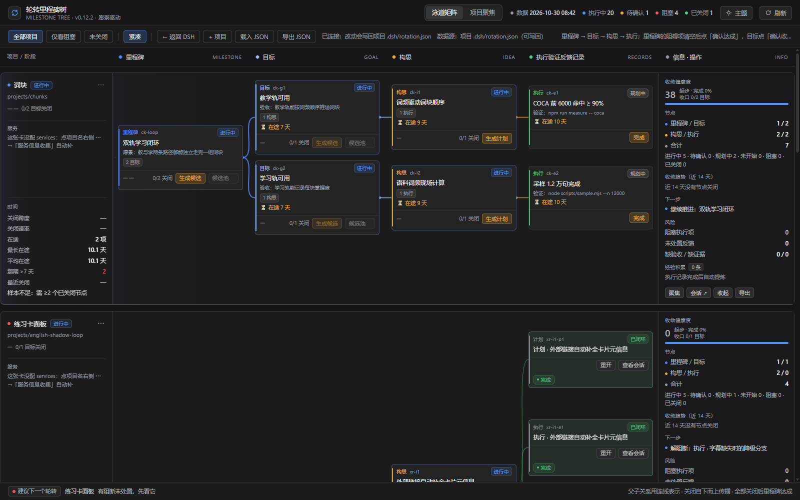
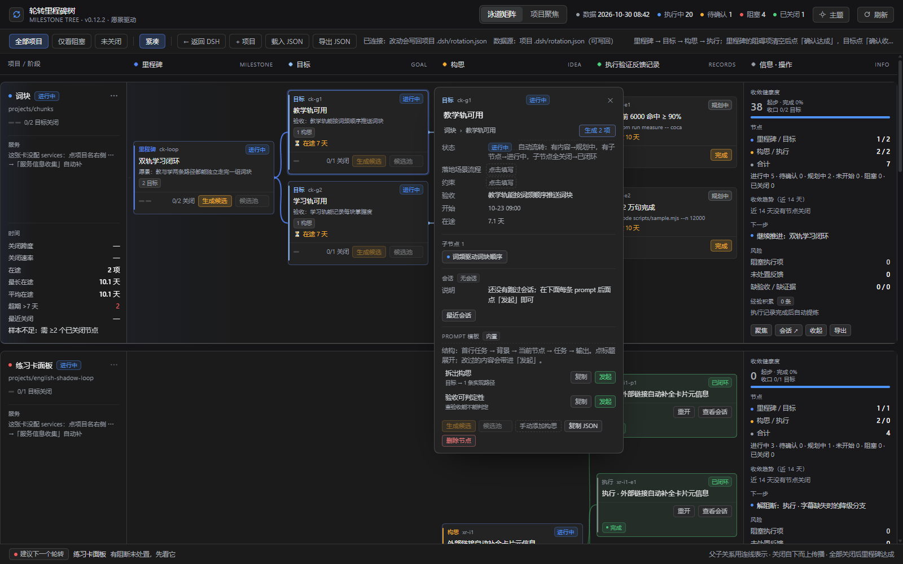
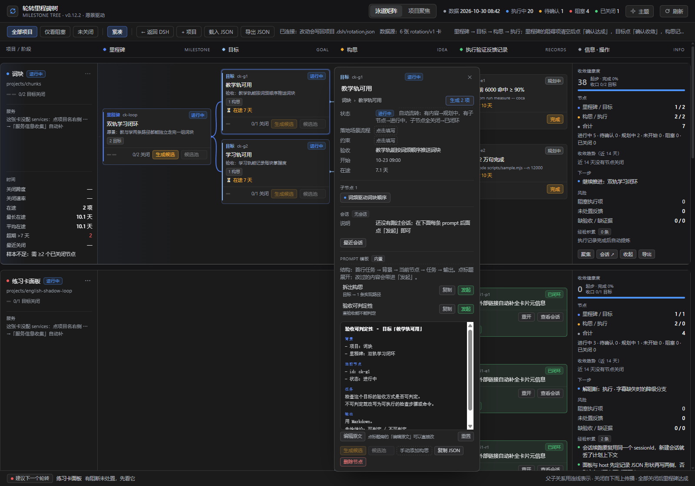
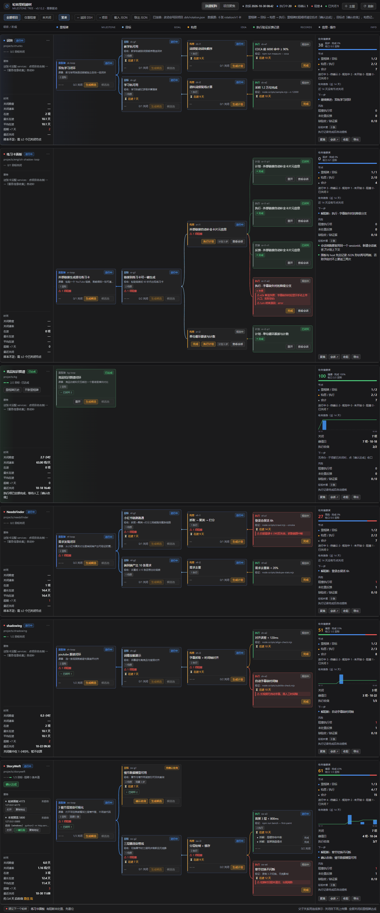

<div align="center">
  
</div>

<h1 align="center">轮转里程碑树面板</h1>

<p align="center">
  <b>一个项目一棵能真正关掉的里程碑树。</b><br>
  DSH 插件：把 <code>里程碑 → 目标 → 构思 → 执行验证反馈记录</code> 放在同一屏，
  每个节点带结构化 prompt，能从节点直接起 DSH 会话，并显示项目服务的实时状态。
</p>

<p align="center">
  <a href="README.md">English</a> ·
  <a href="README.zh-CN.md">简体中文</a>
</p>

<p align="center">
  <a href="#安装">安装</a> ·
  <a href="#用法">用法</a> ·
  <a href="#数据模型">数据模型</a> ·
  <a href="#http-接口">HTTP 接口</a> ·
  <a href="#配置">配置</a> ·
  <a href="#安全边界">安全边界</a> ·
  <a href="#文档">文档</a> ·
  <a href="INSTALL.md">排障</a>
</p>

<p align="center">
  <a href="package.json"></a>
  <a href="LICENSE"></a>
  <a href="https://github.com/Roshenn/dsh-looptree-dashboard/stargazers"></a>
  = 20">
  = 0.2.1-rc.3">
</p>

## 为什么

会话一结束，「为什么做这件事」就跟着蒸发：计划变成一串没人能追溯回目标的 commit，
下一轮会话只能靠猜「当时说的『完成』指什么」。

这个插件把那份意图留在磁盘上、跟着代码走。每个项目先写一条**项目愿景**，再带一个 `rotation/v1`
卡片文件：里程碑（里程碑愿景 + 核心指标 + 阻碍项）、消除这些阻碍的目标、实现目标的唯一一条构思，
以及真正干活的会话留下的执行记录。面板是视图，DSH 是引擎。

## 特性

- **一个项目一条泳道**：里程碑 / 目标 / 构思 / 执行记录四列一眼看完。已关闭的子树折成
  `▸ 已闭环 N` chip 不占版面；执行记录永不折叠，刚跑完的会话始终可见。
- **先愿景，后阻碍**：里程碑第一个字段是 3–6 句愿景（≤ 1000 字），
  写「这个项目要变成什么样」，而不是功能清单；然后是 3–5 条阻碍项：
  缺什么 → 挡在愿景哪一步 → 涉及哪个模块。阻碍项非空时，**确认达成**在三处视图里都禁用——
  这是里程碑不能自己给自己发「达成」的闸门。
- **项目愿景在上，核心指标在下**：`project.vision`（≤ 1000 字）写「整个项目最终要变成什么样」，
  在项目名右侧的 **⋯ → 项目信息** 里改。里程碑再带 2–5 条**核心指标**（一行一条）——
  用可观察的结果证明里程碑愿景已经实现。核心指标衡量愿景，不是验收参数：
  验收仍在目标层（`goal.acceptance`）与执行层（`exec.verify`）。
- **一个目标一条构思**：候选池是同一个槽位的路线对比，不是留着的一堆点子。
  采纳一条即锁定；再生成或再采纳返回 `409 IDEA_EXISTS`；一个目标写第二条构思返回 `422`。
- **从节点发起计划 / 执行 / 反馈**：「生成计划」把结构化 prompt 发进新会话走 `/plan`；
  「执行计划」在**同一会话**先 `/plan off` 再 `/goal <objective>`；
  记录完成后自动追问一次复盘，把经验写回里程碑。
- **prompt 先看结构再发**：唯一实现 `lib/prompt.mjs`，所有 prompt 都由四块拼成——
  背景 / 当前节点 / 任务 / 输出，发送前先展开结构视图。覆盖优先级：节点级 > 卡片级 > 内置。
- **服务就在同一条泳道里**：每个项目列出自己依赖的服务，每 5s 探活，一键拉起时按当前平台
  （`mac` / `windows` / `linux`）挑对应命令。AI 可以读项目自动收集服务——
  结果是草稿，探活、改完、确认后才写回。
- **跨项目一键拉起 / 一键关闭**：工具栏上有两个批量按钮。**拉起全部**先做端口冲突预检——
  两个服务配了同一端口就整批拒绝、一个都不拉，并把冲突列清楚（fail closed）；已在线的服务跳过。
  **关闭全部**按端口结束监听进程（包括你在终端里手动起的），单端口失败只记录、不打断整批。
- **条目字段就是可编辑的列表**：阻碍项 / 核心指标 / 验收 / 场景这几个字段的编辑器可以一条一条
  添加与删除（`＋ 添加一条` / `×`），保存时自动重编号。没有拖拽排序：你敲进去的顺序就是写回的顺序。
- **指标可复算**：收敛健康度、关闭跨度、关闭速率、在途时长、超期数、ETA 全部由树算出，
  不靠手填。公式见 [rotation-card-spec.md](rotation-card-spec.md)。
- **空闲分支高亮**：按并行规范（上游在跑时，下游起不了会话）反推「现在能接活」的分支——
  卡片带「可开工」标签与青绿侧条，泳道头写「运行中 N · 可开工 N」，页脚「空闲分支 →」
  点一下展开并滚到那条分支。只有一条分支且在跑时完全不亮；只有一条分支且空闲时只做弱强调。
  子节点在跑时父节点不算空闲（不会出现「里程碑可开工、三个目标都在跑」这种自相矛盾）。
  单条 / 多条按项目内部数，不新增任何字段。

## 看效果

| 泳道矩阵 | 节点详情 |
|---|---|
|  |  |
| 每个项目一条泳道：里程碑 → 目标 → 构思 → 执行记录。 | 点任意节点看字段、反馈、计划、执行记录与 prompt。 |

| 发送前的 prompt 结构 |
|---|
|  |
| 每条 prompt 发出前都能看到它的四块结构（背景 / 当前节点 / 任务 / 输出）。 |

<details>
<summary>整张矩阵 —— 6 个样例项目全在内</summary>



</details>

<sub>截图是 v0.12 的真面板，数据是 `samples/` 里的 6 张样例卡。</sub>

## 安装

需要 **DSH ≥ 0.2.1-rc.3**、**Node ≥ 20**。插件没有构建步骤——`web/` 直接从磁盘读。

### A. 已有仓库副本（开发推荐）

把仓库登记成 profile 的 link 依赖，用 **DSH 自带的那份 pnpm** 安装：

```json
// ~/.dsh/profiles/<profile>/package.json
{
  "dependencies": { "dsh-looptree-dashboard": "link:../../dsh-looptree-dashboard" }
}
```

然后重启 DSH。因为 profile 指向工作树，更新就是 `git pull`：
`web/` 改动刷新页面即生效，`lib/` 改动要重启 DSH。

### B. 从 GUI 插件市场装

DSH → 插件市场 → 添加插件 → 填**本仓库的绝对路径**
（不是 `.tgz`：市场只接受目录，本仓库也不再产出 tgz）。

完整步骤、profile 陷阱与回滚见 [INSTALL.md](INSTALL.md)。

### 验证

```bash
curl -s http://127.0.0.1:<dsh端口>/rotation/api/health
# {"ok":true,"name":"dsh-looptree-dashboard","version":"0.13.3","base":"/rotation",...}
```

然后打开 `http://127.0.0.1:<dsh端口>/rotation/app/`，或点左栏的 **轮转里程碑树**。
`health` 404 说明 host 半没挂上，见 [INSTALL.md](INSTALL.md)。

## 用法

每天三步：

1. **看泳道**：被阻碍的里程碑是红的，等待收口的目标是黄的，执行记录显示运行中 / 完成 / 失败与结果。
2. **关掉该关的**：子项全关闭的目标进入 **待确认收敛**，确认后才写 `closed_at`；
   阻碍项清空的里程碑进入 **待确认达成**，确认后快照进里程碑历史，项目留在主泳道。
3. **推下一步**：每个节点都有 prompt 模板，**发起**先预览 prompt，再在项目的 `workspace` 里起真实会话。

每次编辑都写回磁盘，工具栏显示 `已写入 <文件> · <时间>`。

## 数据模型

```
~/.dsh/rotation/registry.json          项目注册表：[{ id, name, workspace, file }]
<workspace>/.dsh/rotation.json         卡片真身（rotation/v1，跟着项目走）

project（卡片里的 `project` 块）
└── vision            ≤ 1000 字：这个项目最终要变成什么样

milestone（一张卡一个）
├── vision            3–6 句，≤ 1000 字
├── metrics[]         2–5 条核心指标：证明愿景达成的可观察结果
├── blockers[]        缺什么 → 挡在愿景哪一步 → 涉及模块
├── goals[]
│   ├── scenario      3–5 步：操作 / 预期 / 体验 —— 目标验收的唯一依据
│   └── ideas[]       最多一条；采纳即锁定目标
│       └── 执行记录    一次 DSH 会话一条：计划 / 执行 / 反馈 + 状态 + 结果
└── closed_milestones[]    ≤ 10 条快照，点「确认达成」时写入
```

注册表在多台机器间共用（`~/.dsh` 走 git 同步），但 `workspace` 是各机器自己的绝对路径。
本机不存在的 workspace 条目当作「另一台机器的登记」：不显示、不占 id，写回时原样保留。

字段、不变量与面板映射见 [rotation-card-spec.md](rotation-card-spec.md)。

## HTTP 接口

host 半与 client 半都挂在 `/rotation` 下（可用 `basePath` 改）。全部返回 JSON；
写接口先校验、不过返回 `422`，通过后原子写（`tmp` + rename，不留 `.bak`——历史交给 git）。

| 方法 | 路径 | 作用 |
|---|---|---|
| `GET` | `/rotation/api/health` | 版本 + 解析出的路径 |
| `GET` `POST` | `/rotation/api/projects` | 列出 / 注册项目（`{name, workspace, provider?, model?}`） |
| `DELETE` | `/rotation/api/projects/<id>` | 取消登记（保留项目里的卡片文件） |
| `GET` `PUT` | `/rotation/api/cards` · `/rotation/api/cards/<id>` | 读 / 校验后写卡片 |
| `GET` | `/rotation/api/prompts?file=&nodeId=` | 合成 prompt + 摘要 + lint 警告 |
| `POST` | `/rotation/api/action/plan` · `exec` · `reflect` | 在 DSH 会话里跑节点动作 |
| `POST` `GET` | `/rotation/api/run` · `/rotation/api/run/cancel` · `/rotation/api/runs` · `/rotation/api/run-config` | 节点会话与并发上限 |
| `GET` `PUT` | `/rotation/api/services` | 读 / 写卡片的服务配置 |
| `POST` | `/rotation/api/service/start` · `/rotation/api/service/stop` | 一键拉起 / 停止 |
| `POST` | `/rotation/api/services/probe` · `/rotation/api/services/collect` | 服务探活 / AI 收集（草稿 → 预览 → 写回） |
| `GET` | `/rotation/api/services/collect?file=` | 某张卡的待确认服务草稿 |
| `GET` | `/rotation/api/services/all` | 全部项目的服务、端口与冲突（`?probe=0` 不探活） |
| `POST` | `/rotation/api/services/start-all` | 拉起全部离线服务；`409` + conflicts 表示一个都没拉 |
| `POST` | `/rotation/api/services/stop-all` | 按端口结束本机监听进程；远程地址记进 skipped |

面板还会调几个只在界面里用的接口（`/rotation/api/sessions`、`/session`、`/workspaces`、
`/pick-directory`、`/candidates/*`、`/fill`、`/splits`），这些不算稳定契约——要基于它们开发请读
`lib/index.js`。

## 配置

**插件选项**（`cordis.patch.yml` / profile 的 patch 层）：

| 选项 | 默认 | 含义 |
|---|---|---|
| `basePath` | `/rotation` | 路由前缀；和别的插件抢 `/rotation` 时改这里 |
| `provider` / `model` | 跟随 GUI | 把节点会话钉到指定 provider 路由，不用 GUI 默认值 |

**环境变量**：`ROTATION_MAX_CONCURRENT`（默认 `3`），限制动作、会话、服务收集的全局并发。

**服务**写在卡片里，每个命令字段既可以是字符串，也可以是平台映射：

```json
"services": [
  { "id": "panel", "name": "面板 4173", "url": "http://127.0.0.1:4173", "health": "/api/run-config",
    "start": { "mac": "node serve.mjs", "windows": "node serve.mjs" } },
  { "id": "preview", "name": "预览 5800", "url": "http://127.0.0.1:5800",
    "start": { "mac": "python3 -m http.server 5800", "windows": "python -m http.server 5800" },
    "cwd": "/tmp/rt-workspace" }
]
```

平台键：`mac`（也认 `darwin` / `macos`）、`windows`（也认 `win32` / `win`）、`linux`、`default`。
当前平台没有对应命令时，「一键拉起」不出现，服务块会说明原因。

**prompt 覆盖**写在卡片里：卡根 `prompts.<类型>`，或节点上的 `prompts[]`；
优先级 节点 → 卡片 → 内置，详情卡会标注来源。

## 安全边界

除了 DSH 本来就要发出的模型调用，数据不出本机。

- 面板由 DSH 自己的 web server 托管，只监听回环地址。
- **没有鉴权**：host 半设 `access-control-allow-origin: *`，并接受 `x-rotation-token` 头，
  但值是固定的 `in-process`——它只是路由约定，不是密钥。DSH 运行时，本机任意页面都能读写卡片。
  装了本插件就别把 DSH 绑到公网接口。
- **「一键拉起」执行的是卡片里的 shell 命令**：别人写的 `rotation.json` 当作可执行代码看待。
  面板在 spawn 前一定先显示平台、命令与 `cwd`，进程独立成组，可以停。
- 节点会话走进程内 `ctx.agents`，沿用 GUI 的凭据与 provider 路由——插件自己不存任何 key。
- 数据只落两处：项目的 `.dsh/rotation.json` 与 `~/.dsh/rotation/`。卸载插件不会删这两处。

## 已知限制

- 面板没有会话列表与对话历史；执行记录只带会话 id，不带 transcript。
- 只监听回环、不鉴权，这是设计取舍（见上）。
- UI 文案目前只有中文；数据模型与接口是中性的。
- prompt 里的 Markdown 是纯文本，这是故意的——DSH 聊天气泡不渲染 markdown。
- 「关闭全部」按端口找监听进程：Windows 先走 `Get-NetTCPConnection`，再回退 `netstat` + `taskkill`；
  macOS 依赖系统自带的 `lsof`；Linux 回退 `ss` / `netstat`。URL 不是本机回环地址
  （`localhost`、`127.0.0.0/8`、`::1`）的服务记进 skipped、绝不按端口杀——配置里写
  `https://example.com` 不该把本机 `:443` 上的进程带走。

## 开发

```bash
npm run dev            # 假宿主，不装 DSH 也能看 → http://127.0.0.1:4180/rotation/app/
npm run preflight      # lint:plugin → client 契约 → 会话状态机 → 样例 → 打包自检
npm run check          # 对着正在跑的 DSH 验 health / panel / registry
```

单独跑：`npm run lint:plugin`、`mock:client`、`mock:session`、`mock:action`、`mock:prompt`、
`mock:idea-lock`、`mock:closure`、`mock:registry`、`mock:services`、`mock:services-batch`、
`mock:stale-run`、`validate:samples`。旧卡迁移：`migrate`、`migrate:single-idea`、
`migrate:blockers`、`migrate:milestone`——默认干跑，加 `--write` 才写盘。

架构、事件流与目录说明见 [docs/architecture.md](docs/architecture.md)。

## 文档

| 文档 | 什么时候读 |
|---|---|
| [INSTALL.md](INSTALL.md) | 安装、更新、验证、回滚、排障 |
| [rotation-card-spec.md](rotation-card-spec.md) | 手写或迁移 `rotation/v1` 卡片 |
| [docs/architecture.md](docs/architecture.md) | 改 host / client 两半或会话执行器 |
| [docs/prompts.md](docs/prompts.md) | 改 prompt 结构、覆盖规则或 lint |
| [docs/execution-records.md](docs/execution-records.md) | 读计划 / 执行 / 反馈记录格式 |
| [docs/dev-setup.md](docs/dev-setup.md) | 配一台机器来开发这个插件 |
| [CHANGELOG.md](CHANGELOG.md) | 查版本之间改了什么 |
| [docs/devlog.md](docs/devlog.md) | 当前设计背后的历史记录 |

## 贡献

这是个人工具，只是恰好公开。欢迎提 issue 报 bug——附上 `/rotation/api/health` 的输出与控制台报错。
比修 bug 更大的改动请先开 issue，避免数据模型分叉；不想等就直接 fork，MIT 允许。

## 许可证

[MIT](LICENSE) © 2026 jrri
